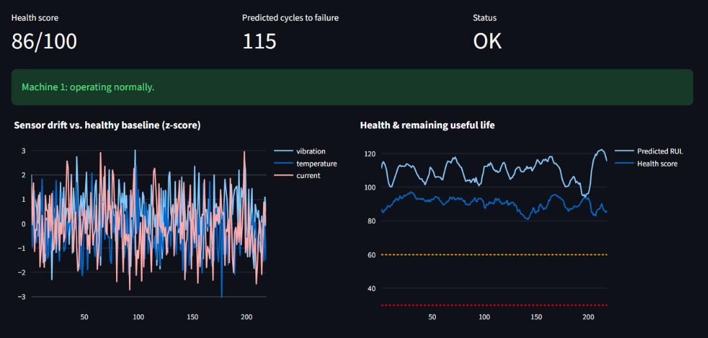
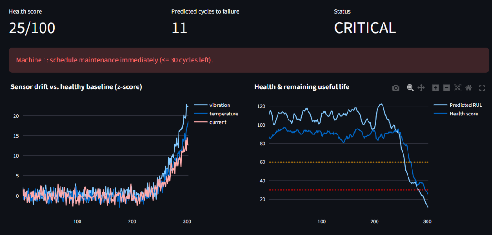
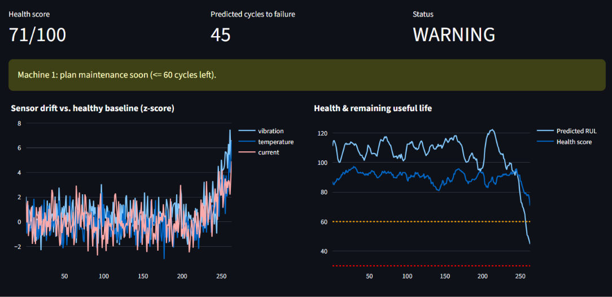
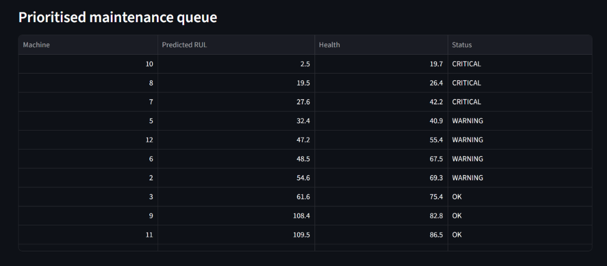

# 🛠️ Predictive Maintenance Platform (FT-03)

**Neural Storm 2026 · Track: Future Tech · Problem Statement: FT-03 Predictive Maintenance for Industry**
**Team Name:** TEAMDUO
**Members:** KHUSHI SAMANTA, NIDHI AGRAWAL

## Problem
Unplanned machine failures cause costly downtime and safety risks. Machines show subtle shifts in vibration, temperature and current long before failing. This platform ingests IoT sensor streams, learns normal behaviour, scores machine health, predicts Remaining Useful Life (RUL) and raises prioritised, low-noise maintenance alerts.

## Approach
1. **Ingest & clean:** sensor streams with missing readings are interpolated per machine.
2. **Feature engineering:** rolling mean, rolling std and slope (window = 15 cycles) for every sensor.
3. **Health score (unsupervised):** an Isolation Forest is trained only on early-life (healthy) data, so it needs no failure labels. This addresses the rarity of labelled failures.
4. **RUL prediction (supervised):** Gradient Boosting regressor on a capped RUL target (125 cycles, the standard C-MAPSS convention).
5. **Alerting:** predictions are smoothed over 5 cycles to cut false alarms, then mapped to OK / WARNING (<=60 cycles) / CRITICAL (<=30 cycles).
6. **Dashboard:** Streamlit app with live health, predicted RUL, sensor-drift charts and a prioritised maintenance queue.

## Tech Stack
Python 3.10+, pandas, NumPy, scikit-learn (HistGradientBoosting, IsolationForest), Streamlit, Plotly.

## Setup and Installation
```bash
git clone https://github.com/<username>/<repo>.git
cd <repo>
python -m venv venv && source venv/bin/activate   # Windows: venv\Scripts\activate
pip install -r requirements.txt
```

## How to Run Locally
```bash
streamlit run app.py
```
Then open http://localhost:8501 in your browser. Models train automatically on first load (about 2 seconds).

## Project Structure
```
app.py            # Streamlit dashboard
src/data.py       # synthetic run-to-failure sensor simulator
src/model.py      # features, health model, RUL model, alert logic
requirements.txt
```

## Results (held-out machines, never seen in training)
| Metric | Value |
|--------|-------|
| RUL RMSE | ~21 cycles |
| RUL MAE | ~16 cycles |
| Alert precision (RUL<=60) | ~0.94 |
| Alert recall (RUL<=60) | ~0.84 |

*Numbers are on simulated data; update this table with your final run (and C-MAPSS results if you add them).*

## Screenshots / Demo

### Healthy machine


### Critical alert (predicted failure approaching)


### Warning alert 


### Prioritised maintenance queue


## Limitations & Future Work
- Trained on simulated data; next step is benchmarking on NASA C-MAPSS and CWRU bearing data.
- Add MQTT + TimescaleDB for true streaming ingestion.
- Try LSTM / 1D-CNN and uncertainty estimates for RUL.

## AI Tools Used
Claude and Chatgpt for code scaffolding and README drafting, GitHub Copilot for autocomplete. All code was reviewed and tested by the team.
